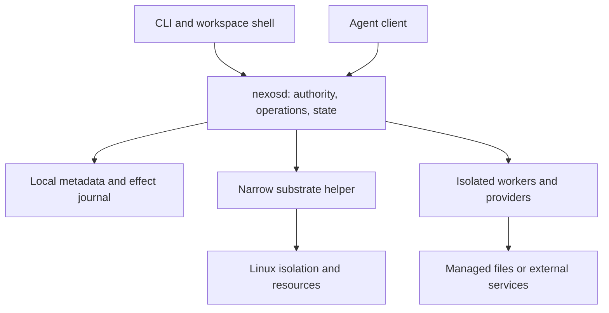

# Architecture

Status: proposed engineering baseline. This document specifies a system to build; it does not assert that the runtime, isolation profiles, recovery paths or distribution already exist. Normative terms apply to implementations claiming NexOS conformance. The [constitution](CONSTITUTION.md) sets product obligations; [protocols](PROTOCOLS.md), [security](SECURITY.md) and [state and recovery](STATE-AND-RECOVERY.md) define the corresponding boundaries.

## 1. Build a managed operating environment first

NexOS begins as an installable Linux runtime and workspace shell. A NixOS image is the reference qualification environment and later a distribution experience. Shipping a customized installer is not the first proof of product value. The first proof is a complete local workflow: create a managed workspace, delegate a bounded operation, inspect its actual effects, interrupt execution, recover, compare a branch and promote supported changes.

The runtime adds semantic identity, typed operations, authority, durable execution records and recoverable managed state above Linux. It retains ordinary processes, files, sockets and the kernel scheduler. A task is an entity that may own several execution attempts. A semantic resource provides identity and policy that survive a path change when a participating provider observes it.

Every workspace exposes its management boundary. Operations outside that boundary remain ordinary Linux activity and cannot be advertised as completely attributable, undoable or policy mediated. Compatibility applications can participate at several depths: a typed provider offers strong semantics; a constrained process offers coarse execution and filesystem observations; an unrestricted legacy application offers only explicitly observed information. The UI must show the difference.

## 2. Minimal process topology

Start with one unprivileged control service, `nexosd`, implemented as a modular monolith in Rust, a narrow privileged substrate helper where required, and isolated workers. The language and storage defaults are engineering choices, not constitutional requirements. A verified existing component may replace a module when it meets the same contracts. Do not turn each entity or module into a network service.

The diagram shows trust and state boundaries, not a required deployment service count. The control service has modules for identity/grants, capability registration, admission, execution coordination, workspace state, artifact records and queries. Modules use typed internal interfaces and one migration owner. The privileged helper accepts a fixed allowlist of operations over resolved resource handles; it never accepts an arbitrary root shell command, arbitrary systemd unit text or arbitrary filesystem path from a model.

Workers receive only their declared input handles, execution identity, bounded grant and configured output locations. Provider processes containing credentials are separate from arbitrary user code. The control service does not load untrusted native plugins into its address space. A plugin may expose a provider protocol, but registering an operation does not give its process authority to execute it.

Process separation is justified by privilege, incompatible dependencies, fault containment or measured scaling. None of those requires a distributed database, service mesh or general message broker in the first local deployment.

## 3. Canonical state and ownership

The baseline metadata store is a local SQLite database with WAL journaling and explicit durability configuration. It is accessed through `nexosd`, not mounted into workers. A single writer per workspace authority prevents conflicting admission decisions. Read models may be rebuilt, but security-critical state is not reconstructed from telemetry.

| State | Canonical owner | Other representations |
|---|---|---|
| Workspace identity, membership and active generation | NexOS control store | UI cache and search index |
| Grants, revocation epochs, reservations and admission | NexOS authority module | Redacted inspection views |
| Managed effect intent, dispatch and outcome | NexOS effect journal | OTel events and human timeline |
| File contents and snapshots | Selected filesystem provider | Artifact metadata and digests |
| External account or document contents | External provider | Versioned observations with freshness |
| Workflow scheduling and workflow history | One selected execution backend | NexOS references and status projection |
| Knowledge assertions, embeddings and semantic indexes | Selected knowledge backend | Authorized context views |
| Nix configurations and realized system closures | Nix provider | Workspace references and promotion records |

These are logical ownership assignments, not instructions to create fresh implementations. P00 can satisfy an owner with an audited existing module. Existing PC-control grants, workspace provisioning and execution adapters must be mapped into one authoritative lineage; copying them into parallel registries without a migration or explicit boundary would violate this design.

An execution backend may own its workflow history while NexOS owns whether a requested effect is authorized. Neither may independently retry the same effect. The backend requests an operation through the broker and records the returned execution/effect identity. NexOS deduplicates at its boundary; the backend does not bypass the journal through a direct credentialed call.

SQLite WAL requires same-host shared state and does not supply cross-host or multi-database atomicity. NexOS therefore keeps local admission, reservation, journal intent and outbox changes in one database transaction. Files and remote services remain separate resource owners. [SQLite WAL documentation](https://www.sqlite.org/wal.html)

## 4. One invocation through the system

1. The authenticated client resolves a capability version and supplies typed input, workspace identity, an expected revision when relevant, a deadline and a request key.
2. Admission binds the request to the authenticated principal, current grant chain and normalized resource scope. Caller-supplied actor names are not identity evidence.
3. Within one local transaction, NexOS validates current authority, reserves enforceable resources, creates the execution/effect intent, and appends an outbox record. Admission does not mean an external action has happened.
4. The dispatcher rechecks the current authority epoch and leases at the effect boundary, resolves handles, prepares the worker/provider and persists the dispatch record before handing over the action.
5. The provider performs the operation and returns a typed receipt, or the outcome becomes uncertain. Providers with meaningful idempotency or reconciliation support declare exactly what that support covers.
6. NexOS records confirmed effects and outputs, settles verified usage, retains unresolved liability, and advances the task only according to its success predicate.
7. Queries expose the resulting state and evidence. The timeline and telemetry consume committed journal events; their failure does not erase or invent an operation.

There is no general transaction spanning step 4, an external service and the local database. Recovery must inspect both sides when acknowledgement is lost. Details belong to [state and recovery](STATE-AND-RECOVERY.md), not an implicit promise of exactly-once execution.

## 5. Execution without a mandatory cloud

The local profile must boot, inspect grants, launch a qualified bounded local job, record effects, cancel, recover a checkpoint, and manipulate workspaces without a model or cloud service. A durable single job is not a claim of arbitrary workflow replay: the job declares its checkpoint format, safe restart points and reconciliation method. Processes with no resumable application state may be restartable or inspectable rather than resumable.

P00 must evaluate existing RobotMind execution facilities before choosing a workflow backend. If Recuriant can run locally with the needed contract, use it. If it requires unavailable services, keep that integration unqualified and preserve the local bounded-job profile. The local controller must not quietly become a second competing general workflow engine. Expanding it into dependency orchestration requires an explicit ownership decision and a justified migration or reuse plan.

The same rule applies to knowledge, inference and identity. Local operational state does not try to implement semantic knowledge management. An optional NoemaDB adapter indexes authorized observations and assertions with provenance. A Bifrost integration reuses the established gateway when available; boot and deterministic operations do not depend on it. Federated identity does not replace the local recovery path. Existing session-relay and telemetry facilities may be useful event sources, but their spools and traces do not automatically become the authoritative effect ledger. See the bounded source inventory in [integration](INTEGRATION.md).

## 6. Recovery, branching and mobility boundaries

A branch names a base revision and a closed manifest of managed resources. It can include a configuration closure, a filesystem snapshot and application checkpoints, each with its own consistency statement. A branch does not automatically copy every byte, network session, credential or physical effect associated with the user.

Promotion constructs a provider-specific plan against an expected head. A compare-and-swap protects the workspace's active-generation record; it does not make all provider mutations atomic. If multiple resources must change, the orchestrator stages supported preparations, records partial outcomes and runs declared compensations where possible. An unsupported provider can make a requested promotion unavailable. See [state and recovery](STATE-AND-RECOVERY.md).

Later federation keeps one authoritative writer for a workspace's authority and effect commitments. Remote execution uses scoped leases and fencing at the resource owner. During a partition, a node may execute only within its still-valid pre-authorized local authority; it cannot silently acquire a fresh budget or global write entitlement. Offline editing creates a branch for explicit reconciliation. Migration transfers an application checkpoint and resource references. It does not promise arbitrary POSIX process migration or active-active writes to one live filesystem.

## 7. Resource and inference scheduling

Linux continues scheduling threads and enforcing supported CPU, memory and I/O controls. NexOS performs higher-level admission and placement: whether a task may start, on which qualified executor, with which deadline, model policy and reservations. This separation keeps probabilistic planning outside kernel resource enforcement.

The kernel distinguishes throttling mechanisms such as `memory.high` from a hard-limit mechanism such as `memory.max`; even hard-limit handling has documented allocation and transient conditions. NexOS must describe the actual controller behavior and test it on the pinned kernel instead of advertising a mathematically exact byte ceiling. [Linux cgroup v2 documentation](https://docs.kernel.org/admin-guide/cgroup-v2.html)

Inference is a capability provider. Requests declare allowed model destinations, privacy class, maximum output allocation and cost policy. Placement may consider local model residency, energy, deadline and queue depth, but switching to a remote model requires existing authority for that destination and data. A fallback is not permission to export context. GPU or NPU accounting is a separately qualified provider capability; CPU cgroups do not imply VRAM isolation.

## 8. Failure and degraded operation

| Failure | Required behavior |
|---|---|
| Model unavailable | Deterministic capabilities and manual inspection continue; model-dependent tasks pause with reason |
| Search or knowledge index unavailable | Canonical resource inspection continues; semantic search is visibly degraded |
| Telemetry collector unavailable | Bounded local telemetry buffer; effect journal remains authoritative |
| Control database not durably writable | Reject new mediated mutations; permit safe read-only diagnostics |
| Missing isolation primitive | Refuse the requested isolation profile; do not fall back to unrestricted execution |
| Provider outcome uncertain | Mark the effect unknown; reconcile before unsafe retry |
| Remote workspace authority unreachable | Show stale state and expiry; obey bounded offline policy |
| Disk pressure | Stop admission before losing recovery records; preserve emergency reserve and pinned checkpoints |

## 9. Architectural decision gates

Before the first runtime claim, P00 and the substrate work must supply exact dependency pins, a bootable qualification image, actual feature probes, a selected execution owner, and an audited integration inventory. Before any hardware promise, [platform qualification](PLATFORM.md) must name and reproduce the full tuple. Before expanding into multi-node execution, prove local crash recovery and stale-executor rejection. Before maintaining a compositor, filesystem or kernel fork, show a reproducible product requirement that the existing substrate cannot meet with a smaller change.

These gates constrain claims, not useful implementation work. They must not become an approval queue for every commit. A failed hypothesis changes the design and its evidence; it is not hidden behind a new abstraction.
