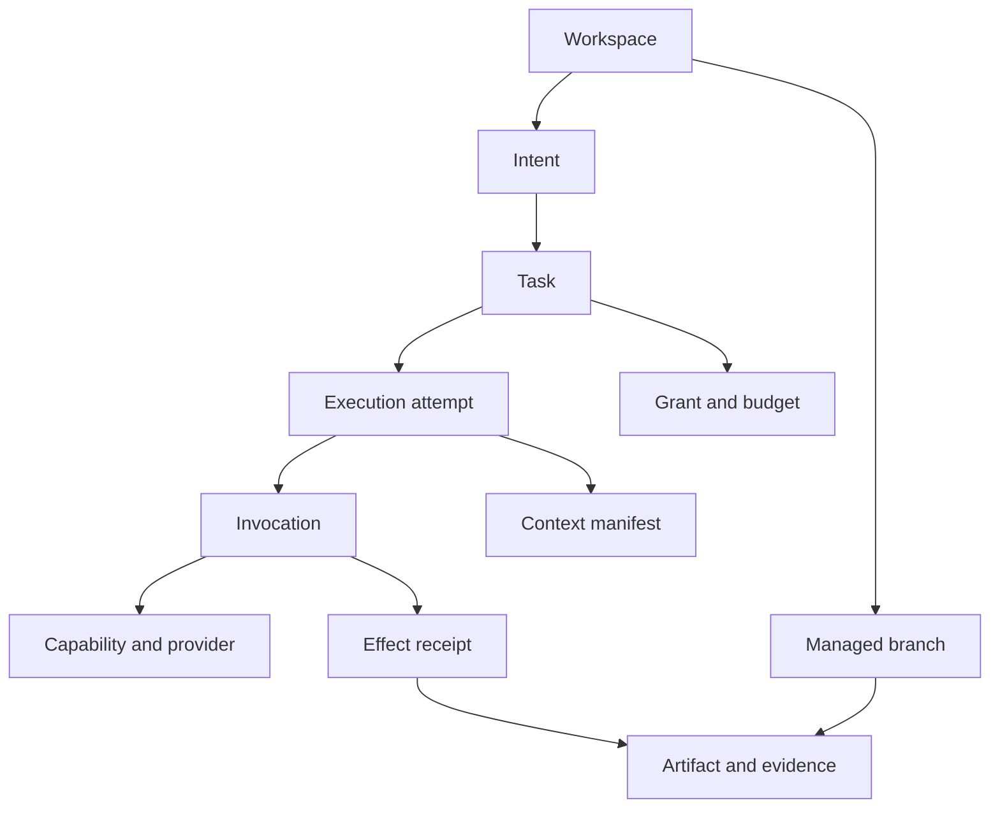

# Domain model and semantic contracts

Status: proposed normative contract `0.1.0`. Field shapes for the first interoperable records are in [the contract bundle](../contracts/nexos.schema.json); this document owns their meaning. This is a semantic API, not a binary ABI or a requirement to implement a graph database.

## 1. Identity and ownership

An object has a stable typed ID, a schema version and an owner. Display names and paths are attributes, never proof of identity or authority. IDs survive provider-observed moves within managed scope; unobserved moves require reconciliation and must not be guessed from filenames. An artifact's content digest identifies bytes, not ownership, permission or truth. Identical private bytes in two workspaces do not imply a shared authorization domain.

The first profile uses opaque `urn:nexos:<kind>:<identifier>` IDs generated by the owning service. Example IDs in this repository are human-readable test data. The runtime uses collision-resistant identifiers and rejects namespace ambiguity. The local authority assigns monotonic object revisions within a nonreused authority incarnation. Restoring old state creates a new incarnation; simply incrementing a restored counter can collide with a previously issued epoch. Wall-clock time is descriptive and deadline-related; it is not a concurrency token.

| Object | Meaning and authoritative owner | Lifecycle and minimum invariants |
| --- | --- | --- |
| Principal | Human, agent or service identity; local identity owner, optionally linked to externally verified identity. | Enrollment, active, disabled. Authentication is distinct from each operation's authorization. |
| Workspace | Persistent work context referencing resources, intents, views, tasks and branches; local workspace registry. | Created, active, archived, deleted under retention. Enrollment does not grant access to arbitrary host files. |
| Intent | Desired outcome and constraints, authored by a principal; workspace owner. | Draft, active, satisfied, abandoned. Human quality goals can require an explicit reviewer; success criteria are not assumed computable. |
| Task | A bounded unit of work toward an intent; exactly one local or delegated execution owner. | Persisted transitions below. Has authority reference, dependencies, acceptance policy, deadline and budget references. |
| Execution attempt | A concrete worker attempt at a task or step; executor owner. | New attempt ID after supported retry; preserves logical invocation identity when retry semantics permit. |
| Capability | Versioned typed operation and provider contract; reviewed capability registry. | Discovered, registered, qualified for a profile, disabled, retired. A discovered tool is not automatically trusted. |
| Grant | Bounded permission delegated by an authenticated issuer; authority registry. | Issued, active, expired or revoked. Scope, destinations, expiry, budget and delegation depth only narrow. Rules preserve resource/operation correlations; they are never flattened into global sets. |
| Invocation | One requested capability operation, bound to exact parameters and preconditions; broker. | Prepared, admitted, dispatched, reconciling, terminal. Logical identity is independent of retries. |
| Effect receipt | An append-only observation of a dispatch outcome; broker plus authenticated provider evidence. | Known not applied, applied, or unknown. Compensation is a new action linked to the original; it does not erase it. |
| Budget | Limit, reservations, usage and enforcement domain; admission/accounting owner. | Available, reserved, settled or disputed. Integers in named units; never floating-point money. |
| Artifact | Immutable bytes plus mutable access/retention metadata; artifact owner. | Created, retained, superseded, tombstoned. Blob visibility is checked on every access. |
| Evidence | Observation tied to a source, subject, method and version; its recorder. | Evidence of execution is distinct from a claim of scientific or product validity. |
| Branch | Isolated candidate state over a declared managed resource set and base versions; workspace owner plus provider adapters. | Creating, ready, changing, validating, promotion pending, promoted, discarded, needs reconciliation. |
| Checkpoint | A consistent resumable state manifest with declared components; task/provider owner. | Prepared, sealed, restored or invalidated. Restoring bytes does not restore expired authority. |
| Context manifest | The authorized, versioned sources and disclosure policy used for one model step; context service. | Prepared, consumed, expired or payload removed. A manifest records context coverage, not correctness of a model's conclusions. |
| View | Versioned declarative interface over authorized queries and operations; workspace owner. | Draft, validated, saved, disabled. Presentation cannot confer permissions. |
| Procedure | Versioned, parameterized composition with effects and preconditions; capability registry. | Proposed, validated, registered, retired. Each run is authorized anew. |
| Resource | Named local or remote files, service, device or compute allocation; relevant resource provider. | Offered, enrolled, leased, unavailable, removed. Hardware resources never silently inherit another principal's authority. |
| Event | Durable fact emitted by an owner, with sequence, causal references and payload custody. | Immutable record plus permitted payload deletion. Event delivery can repeat; consumer application must deduplicate. |

`Policy` and `Delegation` are initially authority rules and grant relationships, not separate services. `Knowledge` is an integration view of claims, observations and procedures, not a second canonical truth store. `Agent` is a principal plus task ownership and model/runtime configuration, not a privileged replacement for a process.

## 2. Core relationships

A task can have several attempts; an invocation can have multiple observations. Do not infer a one-to-one relationship between a process, an agent, a task and a conversation. A process may crash after an external operation; its absence is not evidence that the operation did not happen.

## 3. Runtime task transitions

| From | Event | To | Required evidence or condition |
| --- | --- | --- | --- |
| proposed | Admit | admitted | Scope, dependencies and deterministic admission satisfied; resources reserved. |
| admitted | Start | running | Worker identity and live lease bound to attempt. |
| running | Need human input | waiting_input | Concrete missing input and continuation persisted. |
| running | Need additional authority | waiting_approval | Exact action/plan revision persisted; existing authorized work may continue separately. |
| running | Pause or supported checkpoint | suspended | Checkpoint sealed; resource and in-flight effects recorded. |
| waiting_input / waiting_approval / suspended | Resume | admitted | Current grants, deadlines, budget and dependencies rechecked. |
| running | Lost acknowledgement | reconciling | Possible effect dispatched; retry cannot safely establish outcome. |
| reconciling | Outcome established | admitted / succeeded / failed / cancelled | Provider evidence or separately authorized reconciliation; no invented negative outcome. |
| running | Complete | succeeded | Acceptance observations pass, all effects resolved, usage accounted. |
| nonterminal | Definitive failure | failed | Failure and known effects recorded; unknown effects retain reconciliation state. |
| nonterminal | Cancellation fully settled | cancelled | No new dispatch admitted and all dispatched effects resolved. Unknown effects keep the task in reconciling, with cancellation intent persisted. |

A cancellation request is an event, not an immediate guarantee of a terminal state. Product UI can show “stopping” while the task remains running or reconciling. A terminal execution attempt may leave the overall task unresolved. A failed acceptance check never becomes succeeded because the model declares success. Reopened work creates a new task revision or follow-up task; terminal history is preserved.

Task dependency graphs must be acyclic within an admitted plan. Runtime re-planning creates a new version and rechecks affected authority and success criteria. Plans can add bounded steps within an already authorized purpose; they cannot expand destinations, data access or effect class without authority.

## 4. Effect properties are independent

A single severity label is insufficient. Every registered capability declares at least:

| Axis | Values | Why separate it |
| --- | --- | --- |
| Mutation | none, managed_data, host_system, external_system, physical | A local preview differs from installing a host service or moving a robot. |
| Disclosure | none, local_only, named_destinations | A read can leak private data or incur a remote model charge. |
| Reversibility | not_applicable, reversible, compensatable, irreversible | Deleting a temporary file, cancelling an order and recalling an email have different semantics. |
| Idempotency | intrinsic, provider_key, none | Retrying with a UUID does not make a provider idempotent. |
| Reconciliation | supported, unsupported | Unknown outcomes require evidence from the actual authority. |
| Cost | enforced_limit, bounded_estimate, unknown | External billing may exceed local estimates; the UI must distinguish them. |

A provider that advertises reversible behavior must name its restore preconditions, retained state and retention window. Compensation is another effect with its own cost and authorization. Effects can fail before dispatch, after partial application, or after application with lost acknowledgement. The wire receipt records what is observed, not what the caller hoped.

## 5. Information and retention

Separate operational truth from derived knowledge. Current grants, task transitions, receipts and budget reservations live in the authoritative runtime state. Embeddings, semantic search indices and explanatory summaries are rebuildable projections. NoemaDB may own epistemic claims and long-term semantic memory; it does not become the authority for a Linux grant by storing a description of that grant.

Every captured context item references source identity, revision or digest, observation time, freshness policy, allowed purpose and disclosure destination. Items labeled current must not be past their declared freshness window at preparation. Historical or explicitly stale context requires a reason and visible labeling; it never substitutes for fresh state preconditions or bypasses current read authorization. Retrieval failure is not proof of absence. Confidence scores are not permissions or evidence that a fact is true. The runtime records tool inputs/outputs and concise decision summaries under retention policy; it must not require private chain-of-thought logs to explain an action.

Deletion removes payloads and derived indices according to policy; a minimal tombstone may preserve the fact that an action happened. Digests can themselves reveal membership of known content, so even digest metadata is scoped. Revocation invalidates future reads, caches and subscriptions; bytes already disclosed cannot be recalled by changing a grant.

## 6. Numeric and temporal semantics

Money uses an amount in minor units, currency and exponent. Other quantities include a unit such as tokens, bytes or milliseconds. Limits, reserved and settled amounts must use the same unit. Cross-currency conversions require an explicit quoted conversion; they are not implicit budget arithmetic.

Counters in the first wire profile are nonnegative JSON integers bounded by `2^53-1`; applications needing larger values must introduce a separately negotiated representation. UTC timestamps use explicit `Z` and second or fractional-second precision. Local elapsed-time limits use monotonic time where available; distributed leases require bounded clock assumptions and target-side fencing. A worker's own timestamp cannot renew its authority.

## 7. Scope of the schemas

The included bundle covers capabilities, grants, invocations, effect receipts, context manifests, checkpoints, views and qualification evidence. It deliberately does not pretend to freeze every future entity before a vertical slice exists. P00/P01 turn the first operations and state ownership decisions into concrete storage migrations and provider tests. Later packages extend the contract registry with compatibility and migration evidence.
