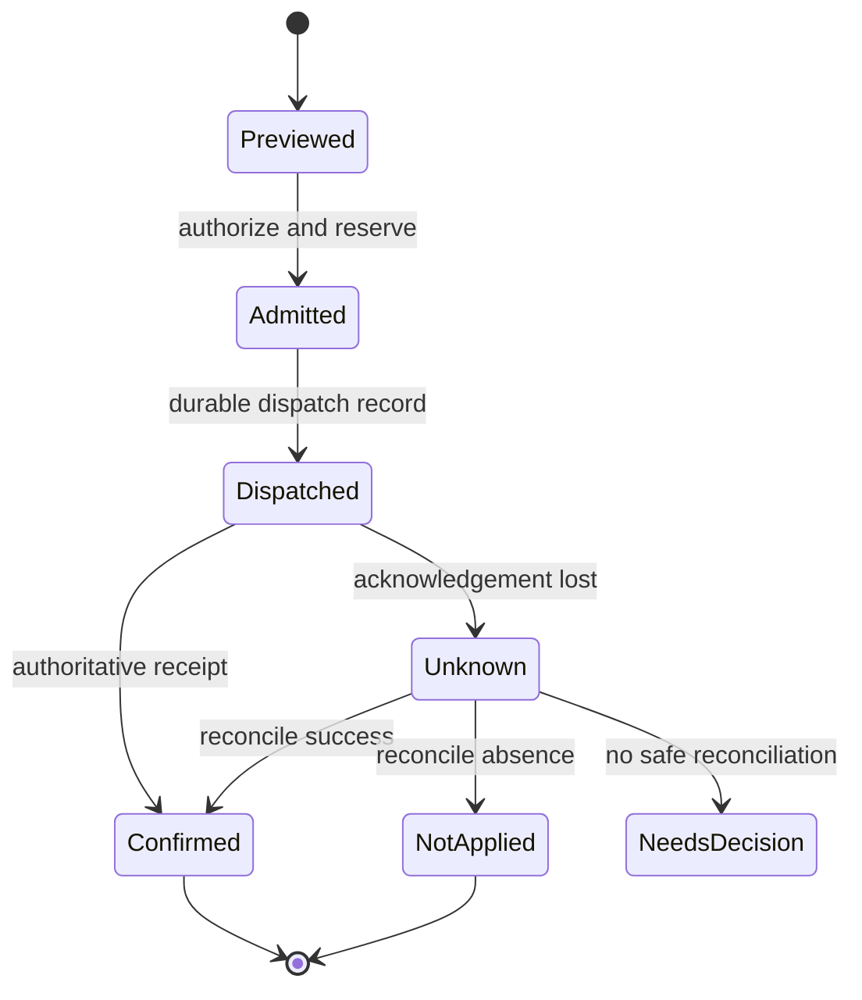

# State, effects and recovery

Status: normative behavior for managed state. This document distinguishes local metadata transactions, filesystem snapshots, application checkpoints and external effects. None is a substitute for the others. The concrete wire schemas and status enums live with the [protocol contracts](PROTOCOLS.md); the stages described here specify their required semantics.

## 1. Scope of durability

Durability means that an acknowledged state transition survives the failures qualified for its platform. The first target is process crash and guest restart on the declared storage stack. Power-loss durability additionally depends on filesystem, virtual disk cache/flush behavior and host storage; it requires a separate fault test. Merely killing a Python or Rust process does not qualify a sudden loss of power.

NexOS must not acknowledge an operation as durably admitted while its only copy is an in-memory queue. Admission atomically records identity, authorized scope, reservations, planned effects and dispatch work in the local control database. Dispatch waits for that transaction's durability barrier. A telemetry exporter, UI cache or workflow status projection cannot replace that record.

For the reference SQLite store, use WAL with `synchronous=FULL` on every writer connection and verify the effective settings at startup. Checkpoint policy bounds WAL growth and long readers; a WAL checkpoint is not an application task checkpoint. SQLite documents that FULL synchronizes each WAL commit while NORMAL can omit that synchronization. Database access remains local; live WAL files are not shared between machines. [SQLite WAL](https://www.sqlite.org/wal.html)

These settings do not defeat faulty storage that lies about flush completion. The test manifest records the virtual disk cache mode and host storage assumptions. Treat I/O errors, full disk and database corruption as explicit operational states. Reject new mutations when their recovery records cannot be durably written.

## 2. Local metadata and external effects

The execution protocol has the following conceptual stages:

This is a recovery diagram, not a replacement for the contract's enum names. Preview creates no execution authority or reservation. Any provider preparation that mutates state is itself an admitted operation with effects. A state needing a decision remains unresolved; it is not successful completion. Failure before dispatch releases reservations after confirming no provider action was handed over. Failure after dispatch may require reconciliation. A timeout means the outcome is uncertain; it does not imply that the provider did nothing.

| Crash boundary | Evidence available | Recovery rule |
|---|---|---|
| Before admission commits | No durable admitted request | Client may resubmit the same request key |
| After admission, before dispatch | Durable intent, no handed-over action | Revalidate authority and dispatch or cancel |
| After dispatch record, before provider acceptance can be known | Possible action | Query provider using durable operation identity |
| After provider applies effect, before receipt commits | Effect may exist without local confirmation | Reconcile; never blindly repeat a non-idempotent action |
| After receipt commits, before client sees it | Confirmed local outcome | Return the stored result for the same scoped key |
| During compensation | Partial recovery | Reconcile each compensating action as its own effect |

The [protocol](PROTOCOLS.md) scopes logical deduplication by authority domain, workspace, capability binding and invocation identity, with a separately checked input/action digest and authenticated principal. Reusing that identity with different input is a conflict, not a cache hit. A provider's idempotency guarantee must name its scope, retention interval and replay response. Once its deduplication window expires, a previously safe retry may become unsafe. NexOS records that boundary and refuses to pretend otherwise.

Event delivery may be at least once. Consumers deduplicate by stable event identity; ordering is guaranteed only within the explicitly sequenced authority stream. Global wall-clock order is not a causal order. Do not merge status by "last timestamp wins" when a late receipt can legitimately contradict a timed-out attempt.

## 3. Reservation and settlement

Reservation is committed with admission. It consumes the shared ancestor budget, including delegated suballocations. Providers with strict limits receive a dispatch allowance that is no broader than the reservation. Multiple independent child counters cannot each spend the parent's full remaining balance.

Settlement records measured usage, quoted terms and the source of measurement. Unused reservations may be released when a no-further-effect condition is known. If the external outcome or final bill is unknown, preserve the reservation or a separately visible unresolved liability. Do not free capacity simply because the local worker died. Reconciliation can settle late usage exactly once in the control store; it cannot force an uncooperative external vendor to charge exactly once.

Cancellation affects future execution. It leaves already confirmed artifacts and charges visible. The system can offer a separate compensation plan, with new authority where required. Cancellation and compensation never rewrite history to make the original effects disappear.

## 4. What a branch contains

A branch manifest identifies:

- Workspace ID, base generation, branch head, owner and creation authority.
- Every included resource's provider, stable ID, version or digest, and consistency level.
- The source configuration closure and supported application checkpoint references.
- Excluded resources, external accounts, live sessions and opaque state.
- Credentials required upon resume, referenced by identity rather than copied secret bytes.
- Pinned recovery artifacts, storage reservations and expiration/garbage-collection policy.

The first qualified branch scope is deliberately concrete: one managed project tree, its declared tool environment and supported local job state. It excludes arbitrary host configuration, a browser's unexported session state, unrelated home directories and external side effects. A later provider can expand the scope only with its own snapshot, promotion and failure contract.

A read-only base and a writable child must have distinct write boundaries. Do not give a worker a writable mount of the base and hope it respects a path convention. For Btrfs, snapshots share extents but writes to a snapshot do not modify the original subvolume; nested subvolumes are separate snapshot boundaries, and a snapshot on the same device is not a backup. NexOS enumerates nested resources or rejects incomplete coverage. [Btrfs subvolume documentation](https://btrfs.readthedocs.io/en/latest/btrfs-subvolume.html)

A portable provider may use a full copy instead of copy-on-write if it preserves the declared semantics and records its cost. It must not call a writable hard-link tree an isolated branch. Unsupported operations return a precise capability error rather than silently becoming less isolated.

## 5. Application consistency

Filesystem consistency is insufficient for an application spread over several files or services. Each provider declares one of: immutable artifact, crash-consistent snapshot, application-consistent checkpoint or opaque/unmanaged state. The UI must retain this distinction when presenting recovery options.

An application-consistent checkpoint uses its documented backup/checkpoint interface, or stops/quiesces the application and verifies the resulting state. A SQLite application may use the online backup API; blindly copying only the main database file while a live WAL exists is not the reference backup procedure. [SQLite backup API](https://www.sqlite.org/backup.html)

For multiple resources, the manifest records whether a shared cut was established. Independent snapshots taken at different times are not automatically a mutually consistent checkpoint. If an application cannot be quiesced or replayed from a valid cut, label that limitation and prevent claims that depend on it.

Open handles are part of the threat model. Stopping new broker requests does not revoke an already opened writable file descriptor. Before sealing a generation for promotion, fence and stop all authorized writers to that generation or use a provider that produces a truly immutable snapshot while writes continue in a separate branch. Never promote a writable directory still held by an untrusted worker as the authoritative immutable state.

## 6. Promotion protocol

Promotion is a reviewed change plan against a known base and current head. It is not a universal merge operation. Text files may use a three-way merge; binaries may require choosing one version; database changes require an application migration; running services require a staged activation and health contract.

1. Resolve the branch's source and destination versions and the complete resource/dependency closure of the selected changes. Selective promotion cannot omit a dependency required to make the result coherent.
2. Compute a plan containing additions, removals, conflicts, expected revisions, required authority, downtime and reversibility for each provider.
3. Obtain preparations where supported: immutable artifacts, validated candidate configuration, tested migration, reserved storage and recovery references. "Prepare" is a provider capability, not a promise invented by the coordinator.
4. Revalidate the destination head, current grants and provider preconditions. Acquire the required per-resource lease/fence. Competing promotion plans may both be previewed, but only one can commit against a given expected head.
5. Apply provider actions in the declared order, recording each effect and receipt. Halt on unclassified uncertainty. The workspace head update uses a compare-and-swap and records the completed promotion's manifest.
6. Verify the resulting supported invariants and report whether activation succeeded, partially applied, was compensated, or needs intervention. Release only reservations no longer required by recovery.

The head pointer's atomic update protects that pointer. It does not atomically restart services, switch a kernel, merge data, change a remote account and update a desktop at once. During activation, queries must show the transition and prevent inconsistent assumptions. Plans requiring truly atomic behavior across unsupported providers are rejected or decomposed with the user-visible partial-effect semantics.

If step 5 fails, compensation is a new recorded action based on the actual applied subset. It can itself fail or be unavailable. Retain the previous generation and recovery material until the retention policy permits collection. A compensation is not equivalent to historical erasure, and some effects remain irreversible.

## 7. Nix configuration versus mutable state

A NixOS generation describes the built system configuration. Its availability makes configuration selection and boot recovery valuable, but application data needs a separate strategy. The NixOS manual documents application-specific major-version migration procedures; switching configuration does not imply that a migrated database can be opened safely by the older service. [NixOS manual](https://nixos.org/manual/nixos/stable/)

The Nix provider must expose build, validation, activation and configuration rollback as distinct operations. Activation records service-level health and any migration side effects. A rollback plan checks data-format compatibility before restarting old binaries. An agent must not change `system.stateVersion` as a generic "upgrade everything" operation. Nix store garbage collection must respect pinned closures required by qualified recovery points.

## 8. Artifact store, retention and provenance

Persist content before publishing a metadata reference to it: write a temporary object in the target filesystem, compute and verify its digest, make required data and directory updates durable, install it under its immutable identity, then commit the reference. Exact syscall sequences depend on the qualified filesystem and implementation. Fault tests must cover each handoff. A crash may leave an unreferenced object, which later collection can safely remove; it must not create a success record pointing only to data that never became durable.

A content hash proves byte identity under the chosen algorithm, not truth, authorship or scientific validity. Provenance records source observations, transformations and assertions separately. Missing, redacted and unverified inputs remain explicit. The evidence stream must not include private prompts or contents merely because they help debugging.

Garbage collection roots include active generations, live tasks, holds, referenced checkpoints and pending reconciliation. A storage policy may stop new admission rather than delete the only recovery point for an incomplete effect. Deleting sensitive payloads leaves an authorized minimal tombstone; the tombstone itself must avoid leaking the deleted content. Shared extents complicate physical-byte accounting, so record measured provider accounting rather than summing logical file sizes as if they were exclusive usage.

## 9. Backup, restore and authority continuity

Backups include metadata, referenced immutable artifacts, provider checkpoints, schema versions and key-recovery instructions. They must be restorable into an isolated test environment with evidence of which tasks, grants and unresolved effects survive. A same-device snapshot is a convenient recovery point, not a disaster recovery claim.

A restored control database must not reactivate old grants, dispatch leases or remote workers simply because an earlier backup says they were valid. Recovery starts in a non-dispatching mode, establishes a fresh authority incarnation, invalidates old execution sessions, and reconciles possible effects since the recovery point. Remote resources reject old incarnations when their provider supports fencing; unsupported providers stay blocked pending reconciliation. Never replay the backlog automatically against the real world after a rollback of authority history.

Schema migration has forward and recovery contracts. Back up with a valid method, apply a versioned migration, verify invariants and record the supported rollback path. If downgrade requires restoring data, say so before migration. Reverting the binary alone is not a downgrade plan.

## 10. Evidence needed to qualify this design

Required fault points include disk full before admission, crash after reservation, crash around dispatch, lost receipt, duplicate delivery, stale generation, active writer during snapshot, provider migration failure, interrupted compensation and restoring an old backup. Test both successful reconciliation and the deliberate unknown state where safe recovery cannot be inferred. A production implementation is conformant only for the tested providers, versions and platform assumptions. This document and a schema validator do not demonstrate runtime durability.
